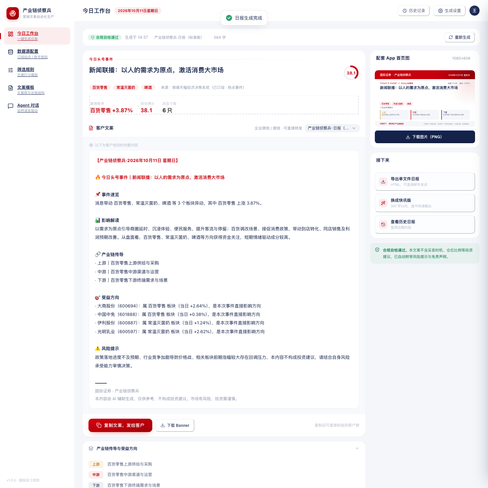
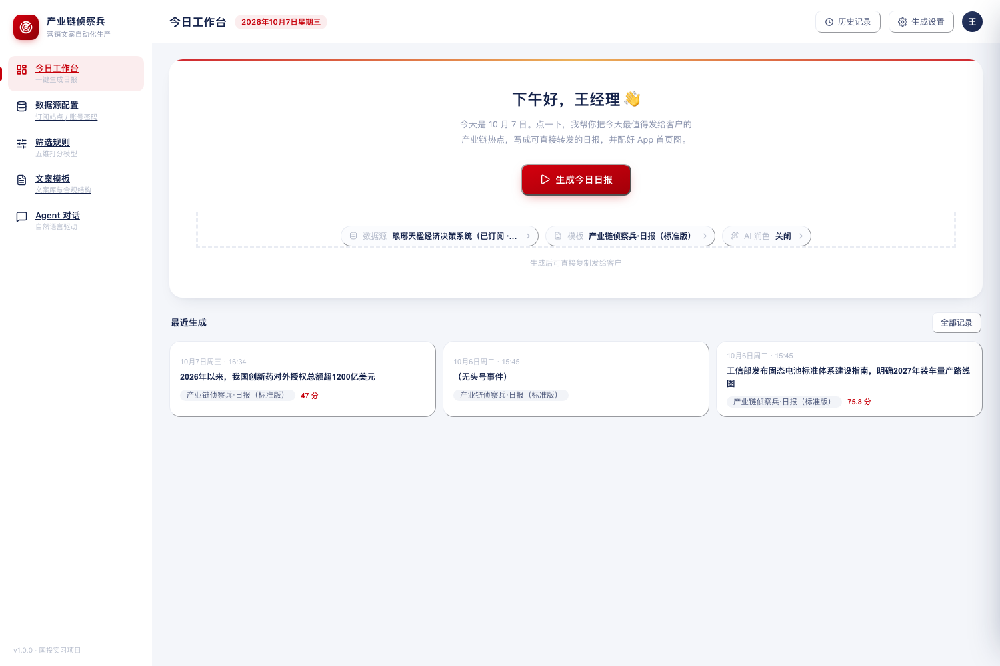
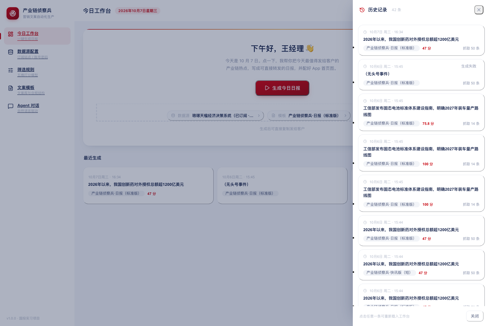
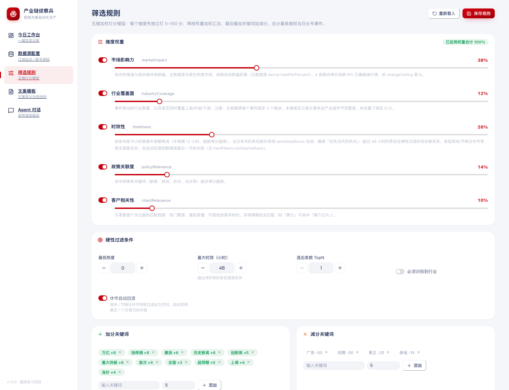
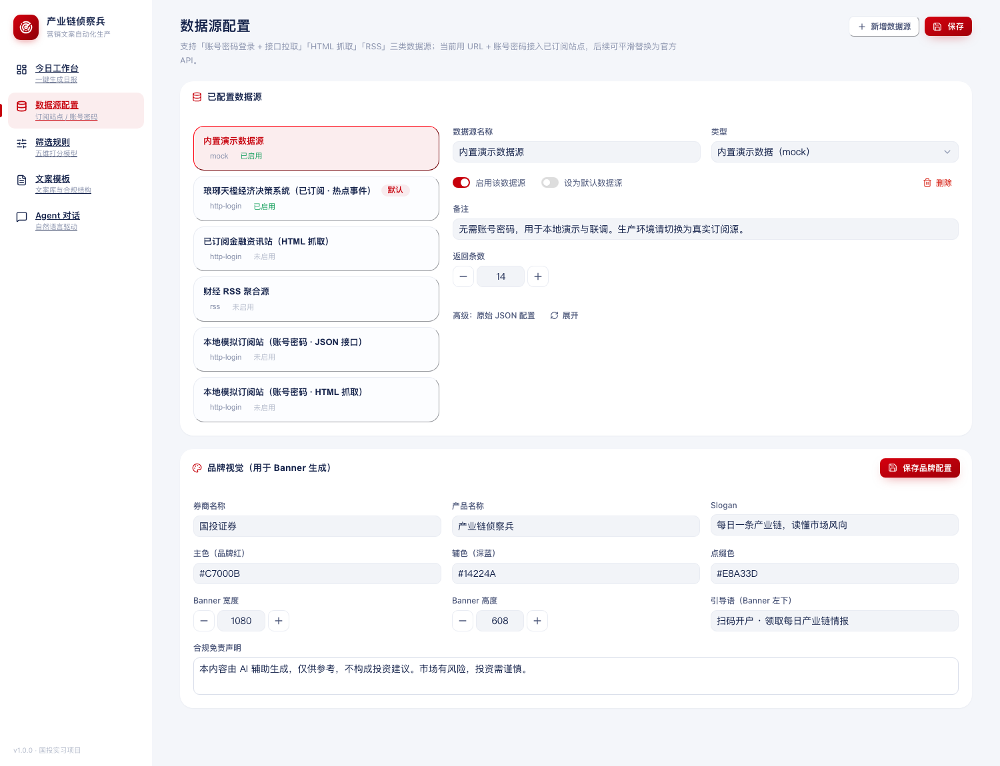
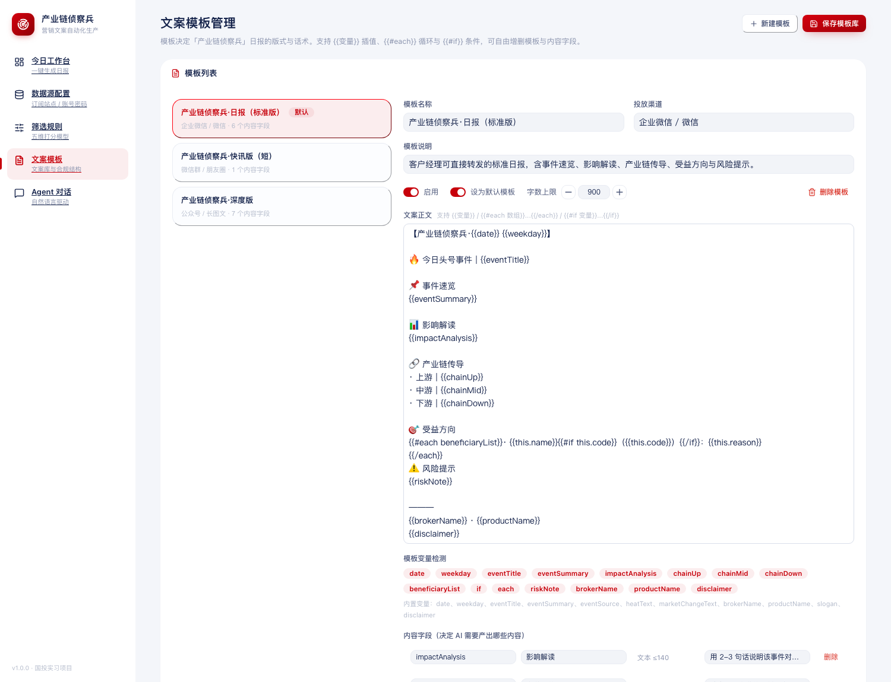
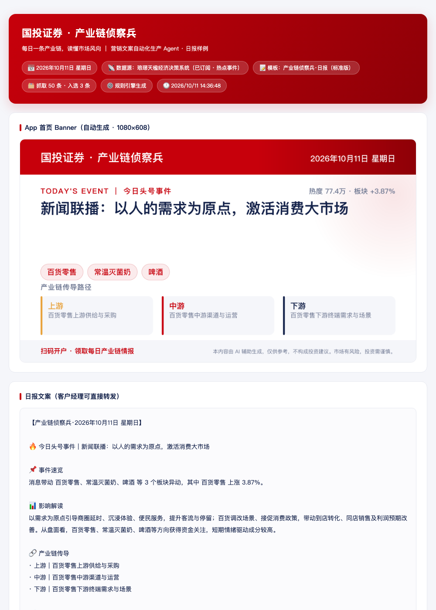
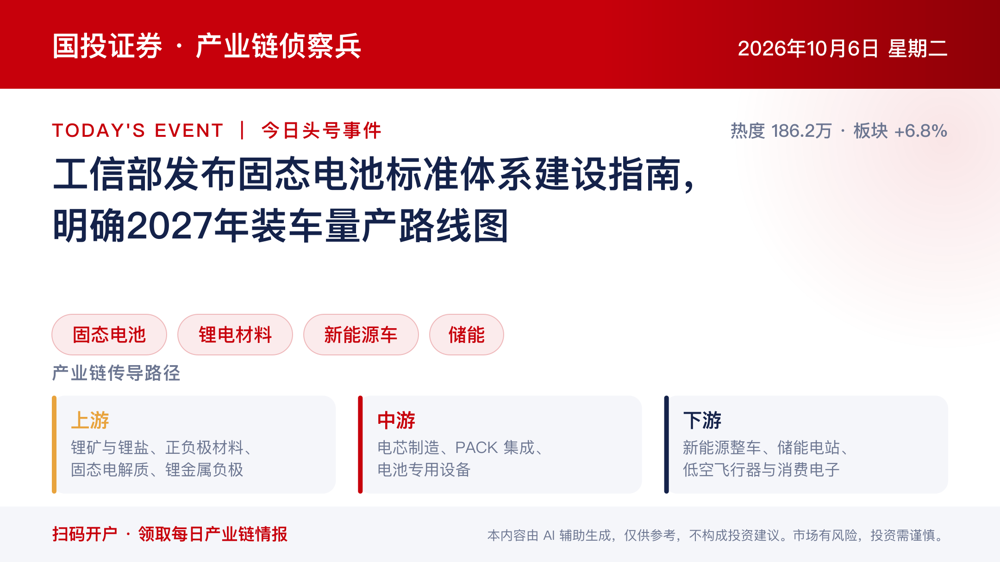

**English** | [简体中文](./README.md)

# Chain Scout — Automated Marketing Copy Pipeline for Brokerages


> Turns each day's market news into **copy a relationship manager can forward to clients as-is, plus a matching app-homepage banner** — in a single command: `fetch → rank → rewrite → render`.

An end-to-end content pipeline for retail brokerage marketing. It ingests market news from a
pluggable data source, ranks it with a configurable five-dimension scoring model, rewrites the top
story into client-ready copy using a template engine (with optional LLM polish), and renders a
brand-compliant banner — all driven by JSON config and a React workbench.

> **Note on language** — the product UI and the generated marketing copy are in Chinese, because
> the target users are Chinese brokerage relationship managers. The documentation is bilingual:
> every doc under `docs/` has an English counterpart (`*.en.md`), and this README is the English
> entry point. Switch to the [中文 README](README.md) for the Chinese version.

---

## Table of Contents

- [Overview](#overview)
- [Screenshots](#screenshots)
- [Core Features](#core-features)
- [Tech Stack](#tech-stack)
- [Quick Start](#quick-start)
- [Usage](#usage)
- [Project Structure](#project-structure)
- [Design Notes](#design-notes)
- [Configuration](#configuration)
- [API Reference](#api-reference)
- [Extending](#extending)
- [FAQ](#faq)
- [Compliance Notice](#compliance-notice)
- [License](#license)

---

## Overview

Relationship managers at brokerages send market updates to clients every day. Done by hand, this
has three pain points:

1. **Picking the story is hard** — hundreds of items a day; judging which one is worth pushing to
   clients is slow and inconsistent across people.
2. **Writing the copy is hard** — rewriting a policy headline into something a client understands
   *without* crossing compliance lines takes real expertise.
3. **Making the artwork is slow** — app-homepage banners must follow brand guidelines, and design
   queues are long.

This project automates the whole chain, and ships a workbench aimed at **relationship managers, not
developers**: open the page, click "Generate today's briefing", copy the copy, send it to clients.

### Design trade-offs

| Choice | Rationale |
|---|---|
| **Config-driven, not hard-coded** | Data sources, ranking rules, copy templates and brand visuals are all JSON. Business users edit them in the UI; adding a data source needs no code change. |
| **Template rendering, not AI text-to-image** | Financial material demands perfect text fidelity — image models routinely garble Chinese headlines. Banners are rendered from SVG templates, so text is 100% accurate. |
| **No LLM required by default** | A rule engine plus a supply-chain knowledge base produces the copy end to end. LLM polish is an optional enhancement that degrades gracefully. |
| **Compliance first** | Templates deliberately omit "what the client should do" fields. The UI runs a compliance self-check. The tool interprets events; it does not give advice. |

---

## Screenshots

> The UI is in Chinese by design — the end users are Chinese brokerage relationship managers.

**① Today's workbench (result state)** — top story, client-ready copy, and the app banner.
Internal pipeline mechanics (9 steps, five-dimension scoring) are tucked into a collapsed section;
the first screen shows only what you can send to a client:



**② Workbench (empty state)** — a single primary action; data source / template / LLM polish are
demoted to a quiet "generation settings" popover:



**③ History** — click any entry to reload it into the workbench, copy and banner included:



**④ Ranking rules** — five weight sliders, hard filters, a "last N trading days" window and
keyword boosts. The top panel shows live A-share trading-calendar status:



**⑤ Data source config** — three adapter types managed in one place, plus brand visuals:



**⑥ Copy template management** — edit template body, variables and content fields visually:



**⑦ Exported single-file briefing** — self-contained HTML, ready to email or share:



**⑧ Auto-generated app-homepage banner**:



> The full design rationale (user personas, six design decisions, visual spec, responsive rules)
> lives in [Workbench design notes](docs/design/workbench-design-notes.en.md), with an interactive
> prototype in [工作台设计稿](docs/design/工作台设计稿.html) (Chinese).

---

## Core Features

### ① Pluggable data-source adapters

**Adding a data source means adding one JSON entry — no code.** Three adapter types are supported:

| Type | Use case |
|---|---|
| `http-login` | Subscribed news portals: log in to obtain a cookie/token, then fetch the list (JSON API or HTML scraping) |
| `rss` | Public finance RSS feeds |
| `mock` | Built-in demo data (works immediately after cloning) |

What `http-login` can express:

| Capability | Config keys | Notes |
|---|---|---|
| Login style | `loginMethod` / `loginContentType` | `application/json`, `x-www-form-urlencoded`, `multipart/form-data` |
| Login validation | `successCodePath` / `successCode` / `messagePath` | Many portals return HTTP 200 with a business error code in the body (e.g. `retCode:"000"`), which must be checked explicitly |
| Auth mode | `authMode` | `cookie` (collects `Set-Cookie`), `bearer`, `header` (raw token in `Authorization`) |
| List parsing | `parser.kind` | `json` or `html` (CSS selectors) |
| **Nested structures** | `sectorListPath` / `securityListPath` / `etfListPath` | Handles "event → sectors → stocks/ETFs" payloads typical of professional feeds |
| **Derived fields** | `parser.derive` | Fields the source lacks (e.g. popularity) can be derived from price moves; existing sector commentary can seed the summary |
| **Response cache** | `cache.ttlMinutes` | Reuses a local snapshot within the TTL — **a cache hit skips even the login call**, so development never hammers the real site |

### ② Five-dimension scoring and a trading-day window

Each dimension scores 0–100 independently, then scores are combined by weight, then keyword
adjustments are applied:

| Dimension | Default weight | What it measures |
|---|---|---|
| Market impact | 38% | Popularity (derived from sector moves when the source has none) + sector price change |
| Industry coverage | 12% | Number of industries touched + whether it spans upstream/midstream/downstream |
| Timeliness | 26% | Half-life decay; **same-day items get a bonus** so today's news wins |
| Policy relevance | 14% | Hits on ministry / planning / meeting keywords |
| Client relevance | 10% | Whether it matches retail-investor hot themes (fuzzy matching) |

The filter window is measured in **A-share trading days** (default: the last 2), not in hours —
see [Design Notes](#-why-the-window-uses-a-trading-calendar-not-hours).

### ③ Copy template engine

- Three built-in templates: **standard briefing**, **flash note**, **long-form deep dive**
- Supports `{{variable}}` interpolation, `{{#each array}}` loops and `{{#if variable}}` conditionals
- Each template declares its own `fields` (which content fields to produce, character limits, writing brief)
- The UI supports adding/removing templates and fields, variable detection, and **live preview against the most recent event**

### ④ Banner generation

- **Vector rendering from templates**: brand bar + top story + sector chips + three-column supply chain + compliance footer
- Size, colours, fonts, slogan and disclaimer all come from `config/brand.json`
- Outputs SVG (vector, sharp at any resolution), optionally converted to PNG
- Line breaking estimates **display width** and never splits an ASCII run, avoiding broken words like `超12 00亿美元`

---

## Tech Stack

| Layer | Choice |
|---|---|
| Backend | Node.js 18+ · Express · TypeScript |
| Frontend | React 18 · Vite · TypeScript · TDesign React · Tailwind CSS |
| Data | better-sqlite3 (optional — falls back to JSON file storage automatically) |
| Imaging | Hand-rolled SVG template renderer + sharp (optional PNG) |
| AI (optional) | CodeBuddy Agent SDK |

---

## Quick Start

**Requirements**: Node.js 18+ (20/22 recommended) and npm.

```bash
# 1. Install dependencies
npm ci            # exact restore from package-lock.json (recommended)
# npm install     # use this on first contact or when upgrading deps

# 2. Start dev servers (backend 3000 + frontend 5173)
npm run dev
```

Open <http://localhost:5173>. **The built-in demo data source is active by default, so a fresh clone
can click "Generate today's briefing" and see the full result — no account needed.**

> ⏱ **First install takes 5–10 minutes**: `better-sqlite3` and `sharp` contain native modules that
> must compile locally. Missing a toolchain is not a problem — both have fallback paths (see
> [Resilience](#-resilience)).

> Want to wire in your own subscribed data source? See
> [Configuration · Connecting a real data source](#connecting-a-real-data-source).

### Single-process deployment (production)

```bash
npm run build     # typecheck + production frontend build into dist/
npm run server    # backend serves dist/ automatically at http://localhost:3000
```

> First boot takes 10–20 seconds (loading cheerio, probing the SQLite native module). This is normal.

### Running tests

```bash
npm test                  # regression tests: trading calendar + trading-day window
npm run typecheck         # typecheck frontend and backend
```

### Continuous integration

Every push / PR runs `npm ci → typecheck → tests → production build → pipeline smoke test` across a
**Node 20 / 22** matrix (that's the badge above).
Config: [`.github/workflows/ci.yml`](.github/workflows/ci.yml).

---

## Usage

### The workbench (daily flow)

The landing page *is* the workbench. Three steps:

1. **Click "Generate today's briefing"** — runs fetch → rank → rewrite → render with live progress;
2. **Read the result** — top story card on top, the full client-facing copy below it (rendered as a
   chat bubble), the banner at the bottom;
3. **Take it** — "Copy copy, send to client"; the sidebar offers "Export single-file briefing" and
   "Switch to flash note".

The top bar also has **History** (reload any past run) and **Generation settings** (data source /
template / LLM polish).

### The five pages

| Route | Page | Purpose |
|---|---|---|
| `/` | Today's workbench | Daily production |
| `/sources` | Data source config | Manage subscriptions, brand visuals |
| `/rules` | Ranking rules | Weights, trading-day window, keywords |
| `/templates` | Copy templates | Edit template body and content fields |
| `/agent` | Agent chat | Conversational interface |

### CLI (for scheduled jobs)

```bash
npm run pipeline                                  # run the full pipeline once
npm run pipeline -- --llm                         # enable LLM polish
npm run pipeline -- --template scout-deep         # pick a template
npm run pipeline -- --source demo-builtin --topN 3
npm run report                                    # also export self-contained HTML into output/
```

Artifacts land in `server/data/`: run records in `runs/*.json`, banners in `banners/*.svg|png`,
data-source response cache in `cache/*.json`.

Example crontab for an automatic 07:30 run on weekdays:

```cron
30 7 * * 1-5 cd /path/to/project && npm run report >> /var/log/scout.log 2>&1
```

### Local integration testing (no subscription account)

```bash
npm run mock-site                                 # start the mock portal (port 4100)
npm run pipeline -- --source local-mock-site      # exercise the login + JSON API path
npm run pipeline -- --source local-mock-site-html # exercise the CSS-scraping path
```

The mock portal deliberately imitates two traits of the real thing: **login is mandatory**, and
**field names are completely different** (`news_title` / `hot_index` / `publish_ts`) — so it
actually verifies that field mapping and the login flow work.

---

## Project Structure

```
├── config/                        ★ Business config (edit here, not code)
│   ├── data-sources.json              ① Data sources
│   ├── filter-rules.json              ② Ranking rules
│   ├── templates.json                 ③ Copy templates
│   ├── brand.json                     ④ Brand visuals
│   └── trading-calendar.json          A-share trading calendar (generated by npm run build:calendar)
│
├── .github/workflows/ci.yml       Continuous integration
│
├── server/
│   ├── index.ts                   Express + SSE entry point
│   ├── api.ts                     Business REST API: /api/scout/*
│   ├── cli.ts                     CLI entry point (cron-friendly)
│   ├── export-report.ts           CLI export of the single-file HTML briefing
│   └── pipeline/
│       ├── env.ts                 .env loading + ${VAR} secret resolution
│       ├── fetchers.ts            Data-source adapters (login / nested mapping / derive / cache)
│       ├── normalize.ts           Normalisation and cleaning
│       ├── trading-calendar.ts    A-share calendar (trading-day test / last trading day / staleness)
│       ├── scorer.ts              Dedupe + trading-day window + five-dimension scoring + sort
│       ├── writer.ts              Template engine + rule-engine field generation
│       ├── llm.ts                 LLM polish (optional)
│       ├── banner.ts              Banner rendering
│       ├── export-html.ts         Single-file HTML template (shared by CLI and API)
│       ├── knowledge.ts           Supply-chain and stock knowledge base
│       └── run.ts                 Pipeline orchestration
│
├── src/
│   ├── App.tsx                    App shell (desktop sidebar / mobile bottom tabs)
│   ├── api/scout.ts               Business API client
│   ├── components/scout/
│   │   ├── atoms.tsx              Design-system atoms (Chip / Card / Fold / ScoreRing…)
│   │   └── HistoryDrawer.tsx      History drawer
│   └── pages/
│       ├── ScoutDashboard.tsx     ① Today's workbench (empty / running / result)
│       ├── SourcesPage.tsx        ② Data sources + brand visuals
│       ├── RulesPage.tsx          ③ Ranking rules
│       ├── TemplatesPage.tsx      ④ Copy templates
│       └── AgentPage.tsx          Agent chat
│
├── tools/
│   ├── mock-subscription-site.ts  Local mock portal (for login-chain integration testing)
│   ├── build-trading-calendar.ts  Generates the A-share trading calendar
│   └── test-trading-*.ts          Regression tests
│
└── docs/                          Design docs and screenshots
    ├── 01-开源选型评估.md              Build-vs-adopt evaluation
    ├── 01-open-source-evaluation.en.md    └ English version
    ├── 02-架构与二次开发.md             Architecture & extension guide
    ├── 02-architecture-and-development.en.md  └ English version
    ├── design/                      Workbench design notes + interactive prototype
    └── images/                      Screenshots used in this README
```

> Docs are bilingual: each Chinese doc has an `.en.md` counterpart with an ASCII filename.

---

## Design Notes

### 🎯 Why the window uses a trading calendar, not hours

This is **a real bug I shipped and then had to fix**.

The source's date field is **UTC midnight** (= 08:00 Beijing time). Filtering on "last 48 hours"
looked reasonable — but a Friday 08:00 item expires at Sunday 08:00. So from **Saturday afternoon
through all of Sunday and Monday morning, the output was empty** — and Monday morning is exactly
when a relationship manager needs it.

Switching to **A-share trading days** gave a rule of:

> **A trading day = Monday–Friday AND not a statutory holiday**

⚠️ One counter-intuitive detail: on "make-up workdays" (调休补班, where a Saturday or Sunday is
reclassified as a working day for the general public) **the stock market stays closed**. So you
cannot test "is it a working day" — you must test against statutory holidays. This was
cross-validated against real market data: 2026-09-20 (a make-up Sunday) and 2026-10-10 (a make-up
Saturday) genuinely have no data.

Two more details:

- **The window's anchor is "the trading day of the newest record in the source", not "today".**
  On a trading morning (especially Monday 07:30) today's data doesn't exist yet; anchoring on today
  would collapse the window to a single day.
- **Staleness guard**: the source may lag by one trading day (covering "today's data isn't published
  yet"), but missing two consecutive trading days is treated as a dead feed and raises an error —
  rather than silently emitting stale content.

Calendar data lives in `config/trading-calendar.json`, generated from the State Council holiday
schedule by `npm run build:calendar`.

### 🔌 How adapters make "one JSON entry = one new data source" work

The chain "login → auth → fetch list → map fields" is expressed as configuration rather than a class
per site:

- Login bodies and URLs support `{{date}}` / `{{username}}` / `{{password}}` / `{{timestamp}}` placeholders
- Field mapping uses JSON paths, which can express nested shapes like `data.list` or `sectorList[].securityList`
- Missing fields can be **derived** (e.g. deriving popularity from sector price moves)
- Responses can be cached, so development doesn't repeatedly hit the real site

### 🔒 Credentials never enter the repo

`credentials` accepts `${ENV_VAR}`. Real usernames and passwords live in `.env` (git-ignored);
`config/data-sources.json` only holds placeholders. Data-source URLs use example domains too.

### 🧮 Keeping sort order stable when scores saturate

Displayed totals are clamped to 0–100, but the **unclamped raw score** is retained internally and
used for sorting. So when several events all hit 100, ordering stays deterministic (the UI shows
`100+`, and hovering reveals the raw score).

### ♿ Resilience

| Situation | Behaviour |
|---|---|
| SQLite native module fails to load | Falls back to JSON file storage automatically; no loss of function |
| No LLM API key configured | Loaded on demand; copy comes from the rule engine (run record marks `llmEnhanced: false`) |
| PNG conversion fails (no sharp) | Degrades to SVG-only output |
| Data source goes stale | Detected by trading day and reported as an error — never silently emits stale content |

---

## Configuration

### Connecting a real data source

The repo ships with the built-in demo source and works out of the box. Wiring in your own
subscription takes three steps:

**① Add credentials** — copy `.env.example` to `.env` and fill in the account:

```bash
cp .env.example .env
# edit .env:
#   ZEN_USER=your-account
#   ZEN_PASS=your-password
```

**② Edit config** — update `subscribed-portal` in `config/data-sources.json`:

```jsonc
{
  "id": "subscribed-portal",
  "enabled": true,                              // set to true
  "config": {
    "loginUrl": "https://api.your-site.com/login",   // your real endpoint
    "listUrl":  "https://api.your-site.com/hot?page=1&size=50",
    "credentials": {
      "username": "${ZEN_USER}",                // keep the placeholder — never inline the secret
      "password": "${ZEN_PASS}"
    }
  }
}
```

**③ Make it the default** — set the top-level `activeSourceId` to `"subscribed-portal"`, or click
"Set as default" on the Data sources page.

**Debugging tip**: fill in only `loginUrl` and `listUrl` first, run `npm run pipeline`, and check the
log for a successful login and the returned item count before adding field mappings.

### Tuning ranking and filtering

**Weights and thresholds**: drag the sliders on the Ranking rules page, or edit
`config/filter-rules.json`.

> **Recalibrate weights after changing data sources.** Run `npm run pipeline` once and inspect the
> distribution of each dimension in `candidates[].breakdown` inside `server/data/runs/*.json`.
> If a dimension takes nearly the same value for every event, it carries no signal on that source —
> lower its weight, or adjust the ceiling parameters (`heatCeiling`, `changeCeiling`) so it uses the
> full 0–100 range.

### Maintaining the trading calendar

```bash
npm run build:calendar    # run after next year's holiday schedule is published (usually Nov–Dec)
```

Years outside the covered range degrade to "any weekday is a trading day". The UI and
`GET /api/scout/calendar` both report the covered years.

### Enabling LLM polish (optional)

```bash
# set CODEBUDDY_API_KEY in .env
```

Or toggle "LLM polish" in the workbench. Failures and timeouts **fall back automatically** to the
rule-engine result and never block the main flow.

---

## API Reference

| Method | Path | Description |
|---|---|---|
| GET | `/api/scout/meta` | Fetch all configuration in one call |
| GET/PUT | `/api/scout/config/:name` | Read/write `brand` / `sources` / `rules` / `templates` |
| POST | `/api/scout/run` | Run the pipeline synchronously |
| GET | `/api/scout/run/stream` | **SSE streaming run**, pushing progress per step |
| GET | `/api/scout/calendar` | A-share calendar status (is today a trading day, last trading day) |
| GET | `/api/scout/runs` | List run records |
| GET | `/api/scout/runs/:id` | Single run detail |
| GET | `/api/scout/export/:id` | **Export the single-file HTML briefing** (banner inlined) |
| POST | `/api/scout/recompose` | Regenerate copy for the same event with a different template |
| GET | `/api/scout/banners/:file` | Banner static assets |

---

## Extending

The architecture guide and extension playbook live in
**[docs/02-architecture-and-development.en.md](docs/02-architecture-and-development.en.md)**, covering:

- Adding a new data-source type
- Adding a new scoring dimension
- Adding or modifying copy templates
- Adjusting the banner layout
- Wiring in a compliance word list

Also see [docs/01-open-source-evaluation.en.md](docs/01-open-source-evaluation.en.md) for
build-vs-adopt reasoning.

---

## FAQ

<details>
<summary><b>The page won't open / keeps loading</b></summary>

The backend takes 10–20 seconds on first boot (loading cheerio, probing the SQLite native module).
If you poll for readiness from a script, allow at least 20 seconds.
</details>

<details>
<summary><b>It says "no usable content after filtering"</b></summary>

The most common cause is **a data source that hasn't updated** (weekends, statutory holidays).
The system reports exactly which day the newest record is from and how many trading days behind it
is, so you can tell at a glance.

During a market closure this is expected; otherwise check that the data source is healthy.
</details>

<details>
<summary><b><code>better-sqlite3</code> fails to compile</b></summary>

It needs a local toolchain. Run `xcode-select --install && npm rebuild better-sqlite3`, or just
ignore it — the app degrades to JSON file storage automatically with no loss of function.
</details>

<details>
<summary><b>No PNG banner was produced</b></summary>

PNG conversion depends on `sharp`; on failure it degrades to SVG-only output (vector, sharp at any
resolution).
</details>

<details>
<summary><b>How do I use my own brand?</b></summary>

Edit `config/brand.json` (brand name, slogan, colours, size, disclaimer), or use the brand visual
section at the bottom of the Data sources page. The site-wide theme colour is controlled centrally
by the TDesign variables in `src/index.css`.
</details>

---

## Compliance Notice

Generated copy and banners both include a disclaimer. **Before production use, wire in your firm's
compliance word list as a second gate**, and confirm that:

- **No investment advice is included** — templates have removed "what the client should do" fields.
  There are no entry/exit timings, position sizing or stop-loss phrasing; only event interpretation
  and supply-chain mapping;
- No return promises, and no phrasing like "guaranteed to rise" / "risk-free";
- Stock-specific content follows advisory-business rules ("beneficiary directions" state supply-chain
  relationships and same-day price action only — no recommendation tone);
- Banner placement requires brand and compliance sign-off.

> All data sources, brand names and credentials in this repository are **example placeholders** —
> replace them with your own. Demo data exists purely for functional verification and does not
> represent any real market view.

---

## License

[MIT](LICENSE)

---

<sub>A personal portfolio project demonstrating an AI-assisted content-production pipeline design.
Not an official product of any institution.</sub>
